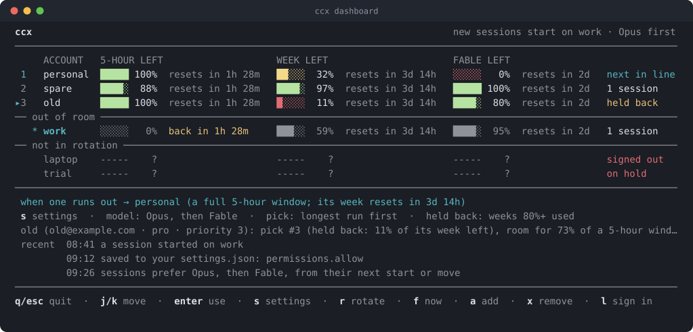

# ccx

Claude Code stops when your account hits its usage limit. If you have more than
one Claude account, ccx moves the running session to an account that still has
room, and the conversation continues where it stopped.

ccx runs on your machine. It talks to Anthropic only about your own accounts,
and sends nothing anywhere else.



## Install

```sh
npm install -g claude-auto-switch
ccx add work        # opens your browser to sign in
ccx add personal    # sign out of claude.ai first, or use another browser profile
ccx on              # make `claude` go through ccx
```

Then use `claude` as you always do. `ccx doctor` checks the setup; `ccx off`
undoes `ccx on`.

Needs Node.js 20 or newer. On Linux, npm compiles `node-pty`, which needs a
C/C++ toolchain (`python3`, `make`, `g++`); Windows and macOS get it prebuilt.

## What happens when an account runs out

1. Claude records the refused turn in its transcript. ccx reads that record,
   not the screen, so text that only mentions limits never moves you.
2. ccx confirms the limit against the account's actual usage.
3. It picks the account that can work longest and swaps that login into the
   running Claude. Subagents and background commands keep going.
4. If Claude opened its limit menu, ccx closes it, then types a short prompt
   telling Claude to carry on.

When a session can't be moved in place, ccx restarts Claude on the new account
with `--resume`, so the conversation survives either way.

## Everyday commands

| Command              | What it does                                                        |
| -------------------- | ------------------------------------------------------------------- |
| `ccx`                | Every account, with how much of its 5-hour and weekly limit is left |
| `ccx dashboard`      | The same, live. Press `s` for settings                              |
| `ccx use <name>`     | Start new sessions on `<name>` and move a running session there     |
| `/ccx`               | Inside Claude: see each account's room and switch this session      |
| `ccx login <name>`   | Sign an account in again                                            |
| `ccx disable <name>` | Keep an account out of rotation (`ccx enable` brings it back)       |
| `ccx doctor`         | Check the setup                                                     |

Every command and setting: [docs/reference.md](docs/reference.md).

## Choosing the next account

By default ccx picks the account that can work longest before any limit stops
it, and uses accounts with 80% or more of their week spent only after healthier
ones. To change that:

```sh
ccx order priority          # use your own order (set it with: ccx priority <name> <n>)
ccx models opus fable       # stay on Opus across accounts, then fall back to Fable
```

How the choice is made: [docs/how-it-works.md](docs/how-it-works.md#which-account-is-next).

## For developers

### How a session switches

Each session runs with its own Claude config folder (`CLAUDE_CONFIG_DIR`)
holding that session's login. To switch, ccx rewrites that login, and Claude
reads it on its next request, so the running process carries on. Everything else
(settings, projects, history, skills, MCP servers) comes from your normal
`~/.claude`. Details: [docs/how-it-works.md](docs/how-it-works.md).

### Building on `ccx state`

`ccx state` prints everything ccx knows as JSON: each account's remaining usage,
reset times, status and which account is next. Combined with `ccx use`, that is
enough to build your own monitor or switcher:

```sh
ccx state | jq '.accounts[] | {name, state: .status.state, until: .status.until}'
ccx use spare --all
```

Fields and stability rules:
[docs/reading-ccx-from-another-program.md](docs/reading-ccx-from-another-program.md).

### Agents on separate accounts

Subagents inside one Claude share its login. `ccx worker` runs a task as its own
headless Claude on its own account, and resumes it on another account if that
one runs out:

```sh
ccx worker --agent coder --cwd ../wt-billing --permission-mode acceptEdits \
  "Make billing retries idempotent. Run npm test before you finish."
```

Options and output: [docs/workers.md](docs/workers.md).

### Contributing

`npm run verify` runs typecheck, lint and tests. The tests use a fake `claude`
(`test/fake-claude/`), so they need no account and spend nothing. To regenerate
the screenshots: `npm run build && node scripts/screenshots.mjs`.

## More

- [Setup details: shells, editors, the status line](docs/setup.md)
- [The dashboard](docs/dashboard.md)
- [Claude Desktop](docs/desktop.md)
- [Claude on a server over SSH](docs/servers.md)
- [Artifact pages](docs/artifacts.md)

## Before you use it

Using several paid accounts to extend your usage may conflict with Anthropic's
terms. Decide for yourself.

ccx never sees your password: logins come from the normal browser sign-in. See
[SECURITY.md](SECURITY.md). MIT licensed, see [LICENSE](LICENSE).
