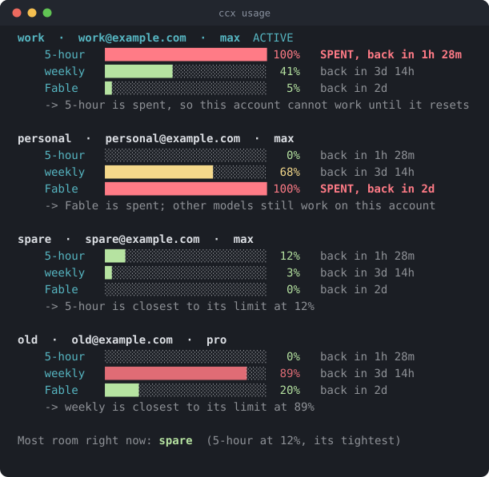
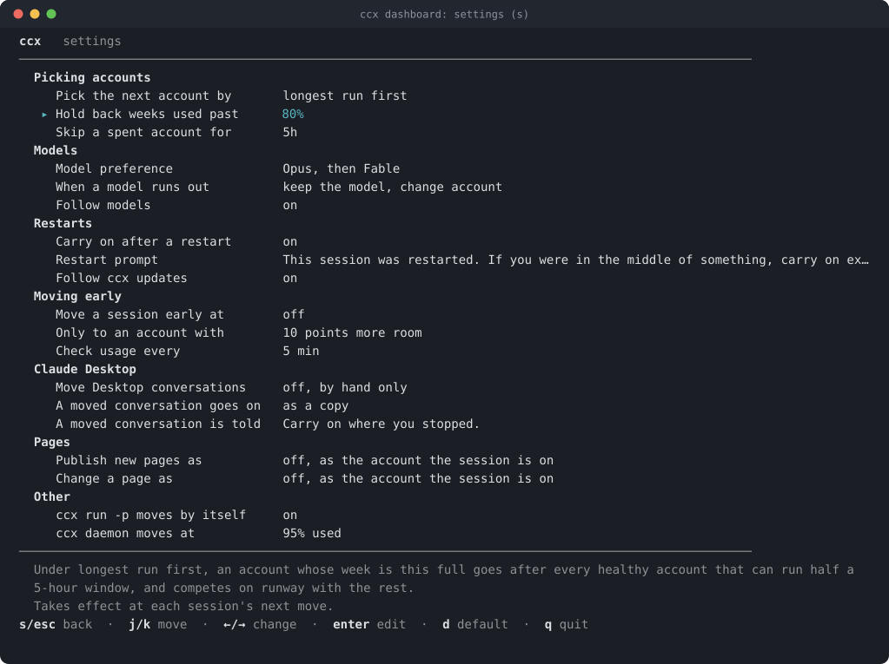

# Seeing where you stand

- **Status line**: the account this session is on and its tightest window,
  e.g. `work 5h 64% left` or `! work week spent resets 2d`.
- **`ccx usage`**: every window on every account, with reset times.
- **`ccx dashboard`**: a live view, drawn to be read at a glance.
  - Accounts you can use come first, numbered in the order ccx would pick
    them, with the next one marked. Accounts that are out of room are listed
    under their own heading, soonest back first, and signed-out, on-hold or
    disabled ones last.
  - Every bar and number is what is LEFT of that window, as on the status
    line: a full bar is an untouched window.
  - When a window resets is beside its own bar: `resets in 4h 16m (3:15 AM)`,
    with the clock time for a wait under a day. The cell is blank while no
    5-hour window is running (one starts at first use). An account that is
    out says `back in ...`, which is when the last thing blocking it lifts,
    under the window blocking it, or at the end of the row when it waits on
    ccx's own record of being refused.
  - The end of a row says what else matters about the account:
    `next in line`, `held back` (its week is nearly spent, so it waits behind
    healthier accounts), `signed out`, `on hold` (Anthropic put the account on hold;
    signing in again does not fix that), and how many sessions are running on
    it. `*` marks the account new sessions start on.
  - A column for one model's own weekly limit (`FABLE LEFT`) appears only
    while that limit is in play: the model is spent on some account, or has
    less left there than the account's week.
  - `when one runs out →` says where a session goes next and why, and
    `recent` the last few things that happened.
  - A row never wraps. As a terminal narrows, the table gives up the clock
    times, then the bars, then the words `resets in`; the numbers and reset
    times stay. On a short window the lines under the table give way first,
    then the accounts scroll to keep the highlighted one in view.

`s` in the dashboard opens the settings: every setting with its value, what it
does, and when a change reaches running sessions. The arrows step a value, enter
types one, `d` puts the default back. `ccx config` shows and sets the same
settings from a shell.

## Keys

| Dashboard key   | Action                                                                                                |
| --------------- | ----------------------------------------------------------------------------------------------------- |
| `enter`         | make the highlighted account the one new sessions start on, and move a running session to it in place |
| `f`             | the same, restarting the session on it instead                                                        |
| `s`             | settings                                                                                              |
| `r`             | rotate to the next pick                                                                               |
| `M` / `o`       | cycle the model preference / the pick rule                                                            |
| `[` / `]`       | move the highlighted account up / down your priority order                                            |
| `e`             | enable or disable the highlighted account                                                             |
| `a` `n` `l`     | add an account, rename one, sign one in again                                                         |
| `x`             | remove the highlighted account, after asking (see below)                                              |
| `d` `m` `t` `D` | Claude Desktop: handoff, mode, carry-on text, move a conversation                                     |
| `q` / `esc`     | quit                                                                                                  |

`x` removes nothing until you answer it. It first says what the removal touches:
any session running on the account (it keeps going until it next moves, then
uses another account), whether new sessions start on it, and whether your
editor is on it. Enter alone or `esc` leaves the account as it is. `y` removes
it from ccx and keeps its folder and login. `purge <name>` also deletes the
folder: the login in it is deleted, and the account must be signed in again to
come back. A folder is not deleted while something is using it: a session
running on the account, your editor, the link `ccx daemon install` keeps, or
another account whose folder is the same one or inside it. `ccx remove --purge`
follows the same rule.
